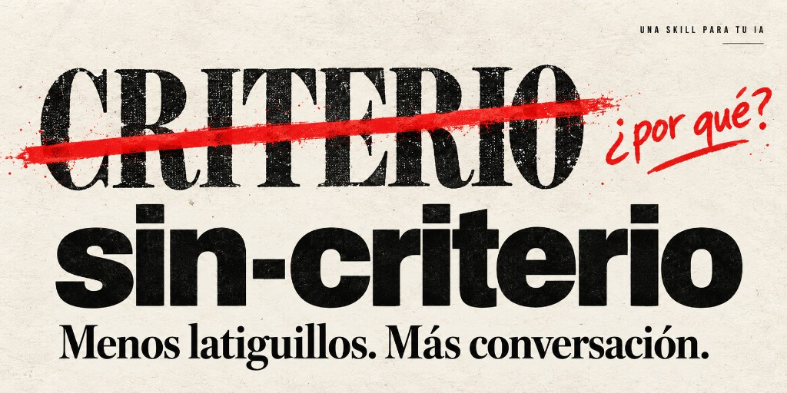

# Sin criterio

**Una skill para que tu IA deje de decir «criterio» y empiece a explicar qué quiere decir.**

Ya vienen los del criterio. Y a veces somos nosotros.

«Hay que diseñar con criterio». «La IA ejecuta, tú pones el criterio». «Lo importante es tener criterio».

Vale. ¿Qué has visto? ¿Qué estás comparando? ¿Qué estás priorizando? ¿Qué te haría cambiar de opinión?

La palabra puede cerrar una conversación justo donde debería empezar la explicación. Esta skill revisa ese uso y obliga a desarrollar lo que queda escondido detrás. Tiene una broma en el nombre y una tarea bastante seria dentro.

## Qué hace

- Evita el comodín al redactar y lo corrige en textos existentes.
- Reescribe la idea completa con las razones que sí aporta el contexto.
- Reconoce cuándo faltan razones, sin inventarlas para que el texto parezca sólido.
- Conserva citas, identificadores y usos precisos como «criterios de aceptación».
- Respeta el tono solicitado. Instalar una broma no debería convertir tus correos en un monólogo.

Cambiar «criterio» por «juicio», «visión», «taste» o «intuición entrenada» sin explicar nada cuenta como cambiarle el bigote al mismo problema.

## Antes y después

| Antes | Después |
| --- | --- |
| Usa la IA con criterio. | Comprueba sus afirmaciones antes de usar la respuesta y revisa los errores que tendrían consecuencias en esta tarea. |
| Elegimos A por criterio de diseño. A mantiene el botón visible; en B queda oculto hasta hacer scroll. | Elegimos A porque mantiene el botón visible; en B queda oculto hasta hacer scroll. |
| Esta propuesta demuestra falta de criterio. | Falta identificar qué decisión de la propuesta se cuestiona y qué problema causaría. |

El último ejemplo no inventa una crítica: hace visible que todavía falta formularla. Más casos y pruebas manuales en [EXAMPLES.md](EXAMPLES.md).

## Cómo usarla

### En una herramienta que admita skills

1. Descarga este repositorio mediante **Code → Download ZIP**, o clónalo.
2. Sigue el procedimiento de importación de skills de tu herramienta. El archivo principal es [SKILL.md](SKILL.md), en la raíz. Si requiere una carpeta con el nombre de la skill, utiliza `sin-criterio`.
3. Pide explícitamente: «Usa la skill sin-criterio para revisar este texto».

La ruta de instalación, la forma de importación y la sintaxis de invocación dependen de la herramienta. Este proyecto contiene instrucciones en Markdown; no incluye un instalador universal. `agents/openai.yaml` aporta metadatos para herramientas que reconozcan ese formato.

### En un chat que permita aportar instrucciones

Adjunta `SKILL.md`, o copia su contenido en las instrucciones del proyecto o de la conversación, y pide:

> Aplica estas instrucciones al redactar y revisar tus respuestas en español durante esta conversación.

Esto utiliza el contenido como instrucciones; no equivale a instalar una skill nativa. Su aplicación depende del modelo, de que conserve ese contexto y de las instrucciones de mayor prioridad de la herramienta. No es un filtro que garantice cero apariciones.

### Peticiones de ejemplo

- «Aplica sin-criterio y revisa este post. Devuelve solo el texto final».
- «Escribe este correo aplicando sin-criterio, con tono profesional».
- «Revisa este párrafo y muéstrame qué ideas estaban sin desarrollar».
- «Evita por completo la palabra en tu propia redacción, también en los títulos».

## Qué cuenta como una mejora

Después de revisar, debería haber algo más concreto que podamos discutir: una observación, una condición, una prioridad o una duda bien localizada. Quitar la palabra y dejar el mismo vacío no pasa la prueba.

Los ejemplos son orientativos: no hay una única reescritura correcta. Puedes comprobar el comportamiento con las peticiones de [EXAMPLES.md](EXAMPLES.md).

## Ficha técnica, aproximadamente

- **Dependencias:** una explicación.
- **Error conocido:** puedes dejar de decir «criterio» y seguir sin decir nada.
- **Compatibilidad emocional:** puede incomodar a quienes escribimos «la IA ejecuta, tú pones el criterio».
- **Telemetría:** la skill no contiene código de seguimiento ni envía datos. La herramienta donde la uses conserva sus propias condiciones de privacidad.

## Contribuir

Abre una issue o una propuesta de cambio con la frase original, el contexto que se puede compartir y una reformulación posible. También sirven casos donde la palabra está bien usada y la skill se pasa de frenada.

«Esto necesita más criterio» no cuenta como incidencia reproducible.

## Licencia

[Licencia MIT](LICENSE). Puedes usarla, adaptarla y compartirla conservando el aviso de licencia.
